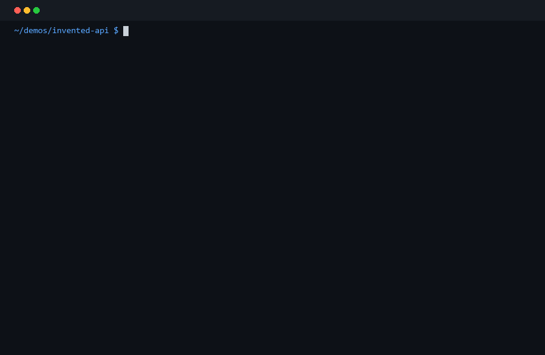

<div align="center">

# HonestCode

**The deterministic verification layer for AI coding agents.**

Catch invented APIs, undefined symbols, wrong calls, and other code hallucinations
before your agent moves on.



[](https://github.com/Fengrru/honestcode/actions/workflows/ci.yml)
[](LICENSE)

</div>

---

## The problem

AI coding agents hallucinate. They invent function names, fabricate library APIs,
and call methods that do not exist.

**HonestCode** is the layer that checks what the agent just wrote against the
repository it is supposed to be grounded in.

```text
Agent
  ↓
writes code
  ↓
HonestCode
  ↓
evidence
  ↓
Agent fixes
  ↓
verified code
```

No LLM calls. No network. Pure AST + symbol resolution.

---

## Demo

The agent was asked to *"add authentication using the existing `UserClient`."*
It generated:

```python
client.refresh_token()
```

The real project only has:

```python
class UserClient:
    def refresh(self): ...
    def refresh_access_token(self): ...
```

HonestCode catches it deterministically:

```text
✗ verification failed — 1 issue in app/login_broken.py

  [invented_api] app/login_broken.py:9
  `UserClient.refresh_token()` does not exist.
  did you mean: refresh_access_token()?
  available methods:
    - refresh()
    - refresh_access_token()
  confidence: deterministic · action: revise
```

Run it yourself:

```bash
cd demos/invented-api
python run.py
```

---

## Why not just use Ruff / Pyright?

HonestCode is not a replacement — it is a verification layer that answers a
specific question: *did the agent's code actually come from this repository?*

| Error | Ruff | Pyright | HonestCode |
|:--|:-:|:-:|:-:|
| Syntax error | ✓ | ✓ | ✓ |
| Type mismatch | — | ✓ | structural only |
| Undefined symbol | ✓ | ✓ | ✓ |
| **Invented API** | partial | partial | **core** |
| **Wrong method call** | — | partial | **core** |
| **Agent-generated API mismatch** | — | — | **core** |

The key difference is **repository grounding**. Ruff checks the file. Pyright
types the call. HonestCode checks whether the call resolves to a real symbol
that exists in the codebase the agent is editing. (HonestCode does not do full
type inference — its structural checks catch mismatched arities, iterating
`None`, and calling constants, not general type errors.)

What a call site is checked against depends on how the receiver's type is known:
an annotation (`client: UserClient`), a constructor assignment
(`client = UserClient()`), `self`/`cls`, and an inline constructor
(`UserClient().refresh()`) are all resolved. A receiver produced by a factory
function (`make_client().refresh()`) is **not** judged — function signatures
carry no return type in the surface model, and guessing there would trade a
missed finding for a false one.

---

## Install

```bash
git clone https://github.com/Fengrru/honestcode
cd honestcode
pip install -e .
```

Requires Python >= 3.10. 100% local.

---

## 30-second setup with Claude Code

```bash
# Add HonestCode as an MCP server
claude mcp add honestcode -- honestcode-mcp
```

Or add it manually to your Claude Code config (`~/.claude/config.json` on
macOS/Linux, `%LOCALAPPDATA%\Claude\config.json` on Windows):

```json
{
  "mcpServers": {
    "honestcode": {
      "command": "honestcode-mcp",
      "args": []
    }
  }
}
```

Restart Claude Code. You now have two verification tools available:

* `scan_file(path)` — legacy tool, returns `issues` plus the new evidence shape.
* `verify_file(path)` — agent-facing tool, returns `status`, `findings` with
  `evidence`, and a human-readable `text` summary.

Try prompting Claude:

```text
Add a login endpoint using the existing UserClient, then run verify_file on the
file you just wrote and fix anything it reports.
```

HonestCode auto-discovers the project root from the file path, indexes the
codebase, and returns grounded evidence.

---

## Real example

```python
# auth/client.py
class UserClient:
    def refresh_access_token(self): ...

# auth/login.py
from auth.client import UserClient

def login(client: UserClient):
    client.refresh_token()  # invented API
```

```python
>>> from honestcode.mcp.tools import verify_file
>>> verify_file("auth/login.py")
{
  "status": "fail",
  "file": "auth/login.py",
  "findings": [
    {
      "line": 7,
      "kind": "invented_api",
      "symbol": "refresh_token",
      "owner": "UserClient",
      "message": "`UserClient.refresh_token()` does not exist.",
      "evidence": {
        "available_methods": ["refresh", "refresh_access_token"],
        "did_you_mean": "refresh_access_token"
      },
      "confidence": "deterministic",
      "action": "revise"
    }
  ],
  "text": "✗ verification failed — 1 issue in auth/login.py\n  ..."
}
```

---

## Agent output protocol

`verify_file` returns evidence an agent can act on directly, not just an error
message:

```json
{
  "status": "fail",
  "file": "auth/client.py",
  "line": 42,
  "kind": "invented_api",
  "symbol": "refresh_token",
  "owner": "UserClient",
  "message": "UserClient.refresh_token() does not exist.",
  "evidence": {
    "available_methods": ["refresh", "refresh_access_token"]
  },
  "confidence": "deterministic",
  "action": "revise"
}
```

---

## How it works

1. **Auto-index** the project (or reuse the cached symbol index).
2. **Parse** the target file with the standard-library `ast` module.
3. **Resolve every call site** to a concrete symbol:
   - infer the receiver type from annotations, constructors, and imports;
   - reconstruct the class's member surface from the repository AST;
   - mark the surface as *unknown* when a base class cannot be resolved or the
     class defines `__getattr__`.
4. **Emit findings** with `kind`, `owner`, `evidence`, `confidence`, and `action`.

The loop is deterministic and auditable.

---

## MCP tools

By default only `scan_file` is exposed. Set `HONESTCODE_TOOLS=all` to enable the
full set, including:

| Tool | Purpose |
|:--|:--|
| `scan_file` | Scan a file for invented APIs, undefined calls, and wrong arities. |
| `verify_file` | Return the agent-facing structured evidence protocol. |
| `index_project` | Build or reuse the project symbol index. |
| `load_project_deps` | Load dependency APIs from `requirements.txt` / `pyproject.toml`. |
| `check_symbol` | Verify a symbol is defined. |
| `check_api` | Verify a library API call exists. |
| `validate_types` | Structural type checks. |

See the old tool reference below for the complete list.

---

## Crash-safe side effects

`verify_file` checks code before it runs. `guards/` covers what happens after:
an agent that retries a tool call can charge a card twice, and no durable
execution engine prevents it — Temporal and Restate both guarantee deterministic
replay of *orchestration* and leave exactly-once external effects to the
application.

```python
from honestcode.guards import EffectStore, SideEffectGuard, durable_scope

guard = SideEffectGuard(session_id="run-42", store_path=".agent/effects.db")

outcome = guard.run(
    "charge",
    target="cus_123",
    payload={"cents": 4200},
    execute=lambda: charge_card("cus_123", 4200),
    approve_irreversible=True,
    scope=durable_scope("order-4711", "charge", "cus_123"),
)

outcome.executed     # False on the retry — a receipt, not a second charge
outcome.effect_id    # stable across a restart, because the key is on disk
```

The interesting part is what `scope` does. Pass it and the effect's identity
comes from the scope rather than the session — which is the difference between a
retry being recognised and a customer being charged twice, because a restart *is*
a new session id. Pass nothing and the guard stays session-scoped.

Refusing is the default direction: an unrecognised action is treated as
irreversible rather than idempotent, and irreversible effects need explicit
approval. A run that dies between the call and the record leaves the effect
`executing`, and the next attempt reports the outcome as unknown instead of
guessing — which is what stops the retry.

For a framework, `integrations/` binds the guard to pydantic-ai, where a
committed effect replaces the tool result instead of re-running the tool. See
[`honestcode/integrations/README.md`](honestcode/integrations/README.md).

---

## Benchmark

HonestCode includes three benchmark suites that run automatically in CI on every
push and pull request to `main`:

### Agent-accuracy benchmark

`benchmarks/agent_accuracy/` is a deterministic, LLM-free benchmark that
measures how well HonestCode catches common agent hallucinations (**recall**).

Each task is a tiny agent episode: the agent writes a broken file, HonestCode
verifies it, then the file is replaced with the fix and verified again.

```bash
cd benchmarks/agent_accuracy
python run.py
```

Current results (6 tasks, deterministic verification):

| task | expected issue | broken detected | fixed clean | broken ms | fixed ms |
|---|---|---|---|---|---|
| invented_method | invented_api (`UserClient.refresh_token`) | yes | yes | 4.18 | 3.78 |
| invented_module_attr | invented_api (`Connection.query`) | yes | yes | 4.19 | 3.95 |
| undefined_import | undefined_symbol (`delete_user`) | yes | yes | 2.69 | 3.55 |
| wrong_signature | wrong_call (`add()`) | yes | yes | 3.56 | 3.35 |
| cross_file_new_symbol | invented_api (`fly`) | yes | yes | 3.85 | 2.45 |
| dep_alias_and_pypi_name | invented_api (`toll`) | yes | yes | 3.44 | 2.9 |

**Summary:** precision 1.0, recall 1.0, F1 1.0, false-positive rate 0.0, median
verify time 4–7 ms on a laptop.

The per-task milliseconds above are one run's output, not a guarantee — they
move a few tens of percent between runs on the same machine. What is stable, and
what the benchmark is gating on, is the first four columns plus the summary's
counts.

The summary line is `python benchmarks/agent_accuracy/run.py` verbatim rather
than a figure copied into this file, because a timing quoted here goes stale the
moment the code gets faster — as one did. Reproduce it with `--format markdown`.

The `cross_file_new_symbol` task pins the agent-session flow (write a module,
then a file importing it — the index must be fresh, never stale); the
`dep_alias_and_pypi_name` task pins dependency grounding through aliased
submodules and PyPI-named requirements (`PyYAML` → `yaml`).

### Real-world false-positive benchmark

`benchmarks/realworld_fp/` measures **precision on real code**: it scans a
vendored snapshot of `psf/requests` (19 files, ~6.4k LOC, Apache-2.0) and
asserts HonestCode reports **zero** findings. Real code exercises the
constructs synthetic tasks never do — stdlib imports, keyword-call style,
`@staticmethod` members, classes inheriting stdlib ABCs, compat re-export
modules — and any finding on this corpus is, by construction, a false
positive.

```bash
python benchmarks/realworld_fp/run.py
# files: 19  findings: 0  elapsed: 0.4s (~20 ms/file)
```

The finding count is the claim; the elapsed time is indicative, and varies with
the machine.

### Performance benchmark

`scripts/benchmark.py` measures the latency of core operations (index, scan,
graph, dead code detection, similarity search) on the repository itself.

```bash
python scripts/benchmark.py                          # text output
python scripts/benchmark.py --format markdown        # table for README
python scripts/benchmark.py --repo psf/requests      # benchmark a real-world repo
```

All three benchmarks run in CI (`.github/workflows/ci.yml`) as separate jobs:
`benchmark-accuracy`, `benchmark-realworld`, and `benchmark-performance`. A benchmark failure blocks
the build if precision or recall drops below 1.0.

See `benchmarks/agent_accuracy/README.md` for the dataset format and how to
add new accuracy tasks.

---

## Architecture

```
honestcode/
├── verify/        # Evidence protocol + repository-grounded verification
├── mcp/           # MCP server layer
├── honest/        # Symbol index + project binding
├── graph/         # Persistent call graph (SQLite)
├── structure/     # AST extraction
├── sandbox/       # Sandboxed execution
├── guards/        # Crash-safe side effects (stdlib-only, extractable)
├── integrations/  # Framework bindings — pydantic-ai today
└── cli.py         # Command-line interface
```

`verify_file` is the agent interface. `scan_file` is the default MCP tool and
returns both the new evidence shape and the legacy `issues` list.

Two of those directories answer a different question from the rest. Everything
above `guards/` asks *is this code consistent with the repository*. `guards/`
asks *did this effect already happen* — an agent that retries a tool call after
a crash can charge a card twice, and durable-execution engines leave exactly-once
external effects to the application. `integrations/` binds the guard to a
framework; pydantic-ai's `wrap_tool_execute` is the first, and a tool result is
replaced rather than re-run when the effect has already been committed.

`guards/` is deliberately stdlib-only and does not depend on this package's
protocols, so it can be extracted into its own distribution. `tests/test_guards.py`
enforces that with an AST import check.

---

## Roadmap

### v0.1 — Repository grounding (now)
- symbol / API / function / class / method / import / call verification
- invented API detection with structured evidence
- auto-index on `scan_file`

### Beyond the roadmap — crash-safe side effects (now)
Not a verification layer, so it has no place in the v0.2/v0.3 sequence below:
`guards/` makes an effect idempotent across a crash, and `integrations/` binds
it to pydantic-ai. It answers "did this already happen", which is a runtime
question rather than a static one.

### v0.2 — Semantic contract verification
- function expects `UserID`, agent passes `User` → suspicious

### v0.3 — Execution verification
- static verification → tests → runtime evidence

### v1.0 — Verification Runtime for Coding Agents
```text
                 Coding Agent
                      │
              ┌───────▼───────┐
              │   HonestCode  │
              │ Verification  │
              │    Runtime    │
              └───────┬───────┘
                      │
       ┌──────────────┼──────────────┐
       ↓              ↓              ↓
   Static          Semantic       Runtime
 Verification     Verification   Verification
       │              │              │
       └──────────────┼──────────────┘
                      ↓
                   Evidence
                      ↓
                     Agent
```

---

## Development

```bash
git clone https://github.com/Fengrru/honestcode.git
cd honestcode
python -m venv .venv
.venv\Scripts\activate  # Windows
# source .venv/bin/activate  # macOS/Linux
pip install -e ".[dev]"
pytest
ruff check honestcode tests scripts
```

Run benchmarks locally:

```bash
# Accuracy benchmark
python benchmarks/agent_accuracy/run.py

# Performance benchmark
python scripts/benchmark.py
```

See [CONTRIBUTING.md](CONTRIBUTING.md) for pull request guidelines.

---

## Security

See [SECURITY.md](SECURITY.md) for vulnerability reporting.

---

## Telemetry

**HonestCode collects no telemetry.** There are no analytics libraries,
no background services, and no phone-home endpoints.

---

## License

[MIT](LICENSE) - Copyright (c) 2026 HonestCode Team
